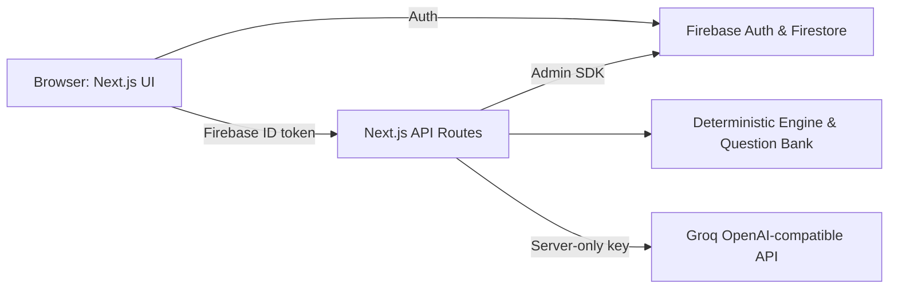

# Practice Studio

An interview-practice application for role-based preparation, **not a hiring assessment**. Built for internship submission and professional demonstration.

## Features

- **Authentication**: Email/password and Google OAuth via Firebase Auth
- **Interview Setup**: Choose role, seniority, interview type, duration, and optional job description
- **Saved Configurations**: Save and manage multiple interview configurations
- **Adaptive Interview Engine**: Deterministic policy with AI-enhanced follow-up questions
- **Multiple Interview Types**: Technical, Behavioral, System Design, Mixed
- **Real AI Evaluation**: Groq-powered structured evaluation with detailed feedback
- **Voice Interview**: Browser-based recording with Groq Whisper transcription
- **Speech Metrics**: Pace, filler words, sentence structure analysis
- **Comprehensive Reports**: Radar charts, strengths/weaknesses, personalized 7-day practice plan
- **PDF Export**: Print/save reports as PDF
- **Security**: Firestore rules, rate limiting, input validation, server-side secrets

## Architecture



## Technology Stack

- **Framework**: Next.js 16.4.6 (App Router)
- **UI**: React 19.3.1, Tailwind CSS 4.3.5
- **Language**: TypeScript 5.9.3
- **Database**: Firebase Firestore (client + Admin SDK)
- **Auth**: Firebase Authentication
- **AI Provider**: Groq (OpenAI-compatible SDK 7.62.0)
- **Charts**: Recharts 3.11.0
- **Validation**: Zod 4.6.7
- **Testing**: Node.js test runner, Playwright 1.65.1
- **Node**: 24.12+

## Local Development

### Prerequisites

- Node.js 24.12+
- Java 21 (for Firebase emulators)
- Firebase CLI: `npm install -g firebase-tools`

### Environment Setup

Copy `.env.example` to `.env.local` and fill in your values:

```bash
cp .env.example .env.local
```

Required variables:

- `GROQ_API_KEY` - Groq API key for AI evaluation and transcription
- `OPENAI_CHAT_MODEL` - Groq chat model (e.g., `llama-3.3-70b-versatile`)
- `OPENAI_STT_MODEL` - Groq speech-to-text model (e.g., `whisper-large-v3-turbo`)
- Firebase project configuration (see below)

### Firebase Setup

1. Create a Firebase project at https://console.firebase.google.com
2. Enable Authentication (Email/Password and Google providers)
3. Create a Firestore database
4. Add a web app and copy the config values to `.env.local`
5. Generate a service account key for Admin SDK (Project Settings > Service Accounts)
6. Set authorized domains for OAuth in Firebase Auth settings

### Running with Emulators (Recommended for Development)

```bash
# Terminal 1: Start emulators
npm ci
npx firebase emulators:start --only auth,firestore --project demo-interview-test

# Terminal 2: Build with emulator config
NEXT_PUBLIC_USE_EMULATORS=true npm run build

# Terminal 3: Start app in demo mode
DEMO_MODE=true FIREBASE_PROJECT_ID=demo-interview-test \
FIREBASE_AUTH_EMULATOR_HOST=127.0.0.1:9099 FIRESTORE_EMULATOR_HOST=127.0.0.1:8080 \
npm run start
```

Open http://localhost:3000 in a browser.

### Running without Emulators (Production-like)

```bash
npm run build
npm run start
```

## Testing

```bash
# Unit tests
npm run test:engine
npm run test:rubric
npm run test:speech

# Linting & formatting
npm run lint
npm run format:check

# Type checking
npx tsc --noEmit

# E2E tests (requires emulators running)
npx playwright test tests/e2e --workers=1
```

## CI/CD

GitHub Actions workflow (`.github/workflows/ci.yml`) runs:

- Linting, formatting, TypeScript typecheck
- Unit tests (engine, rubric, speech metrics)
- Production build
- E2E tests with Firebase emulators
- Vercel preview deployment (on PRs)

## Deployment

### Vercel (Recommended)

1. Connect your GitHub repository to Vercel
2. Add environment variables in Vercel dashboard
3. Deploy - Vercel auto-detects Next.js

Required Vercel environment variables:

- All variables from `.env.example` (except emulator settings)
- `NEXT_PUBLIC_USE_EMULATORS=false`
- `DEMO_MODE=false`

### Firestore Rules

Deploy security rules:

```bash
firebase deploy --only firestore:rules
```

## Demo Walkthrough

See [docs/DEMO_SCRIPT.md](docs/DEMO_SCRIPT.md) for a complete demonstration script.

## Project Structure

```
├── app/                    # Next.js App Router pages
│   ├── api/               # API routes
│   │   ├── session/       # Session management (start, answer, finish)
│   │   └── transcribe/    # Voice transcription
│   ├── interview/         # Interview session pages
│   ├── report/            # Report page
│   ├── setup/             # Interview setup page
│   └── login/             # Authentication page
├── lib/                   # Core libraries
│   ├── engine.ts          # Deterministic interview engine
│   ├── question-bank.ts   # Question selection logic
│   ├── openai.ts          # Groq AI integration
│   ├── rubric.ts          # Scoring & aggregation
│   ├── schemas.ts         # Zod validation schemas
│   ├── firebase-*.ts      # Firebase client/admin
│   └── speech-metrics.ts  # Voice analysis
├── data/questions/        # Question banks (JSON)
├── prompts/               # AI prompts
├── tests/                 # Unit & E2E tests
├── docs/                  # Documentation
└── firestore.rules        # Security rules
```

## Security Considerations

- All AI API keys stored server-side only
- Firestore rules enforce user data isolation
- Rate limiting on API endpoints
- Input validation with Zod schemas
- Prompt injection protection in AI prompts
- No secrets in client bundle

## Known Limitations

See [docs/KNOWN_GAPS.md](docs/KNOWN_GAPS.md) for current limitations and future work.

## License

Internship project - educational use.
